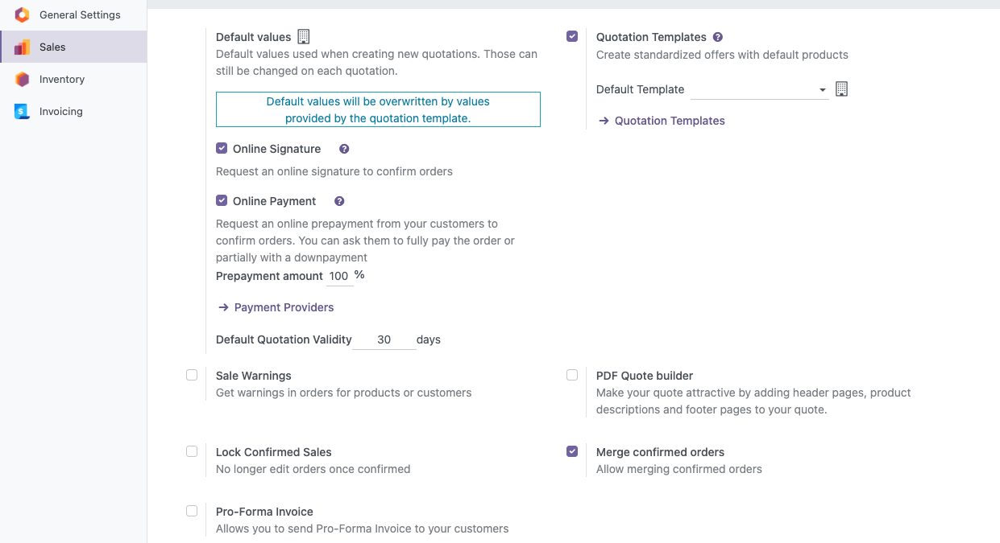

Quotations, sent or not, can always be merged. To merge confirmed orders as
well:

1. Go to **Settings > Sales**, section **Quotations & Orders**.
2. Enable **Merge confirmed orders** and save.

The Sales settings page is only shown when the Sales application
(`sale_management`) is installed.
