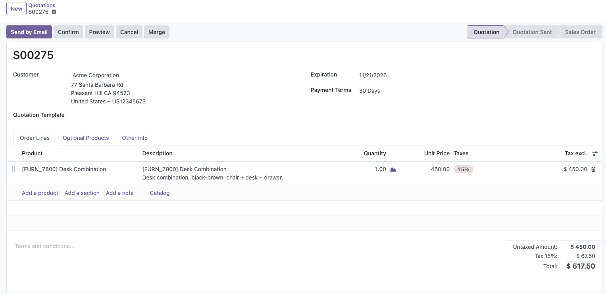
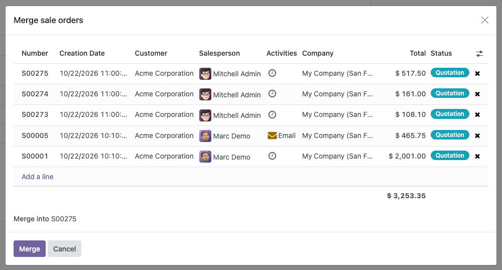
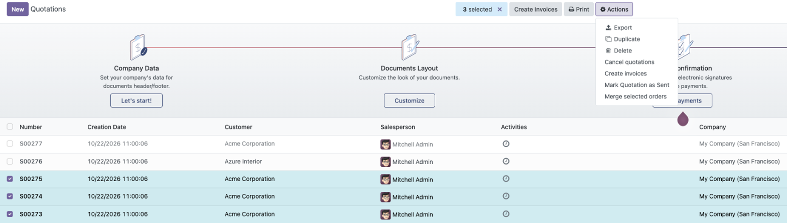
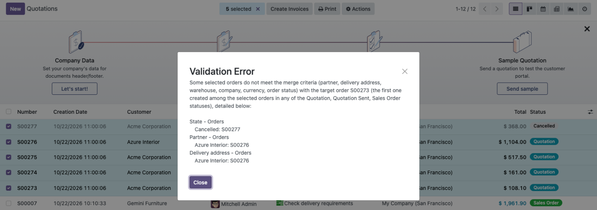

Merge criteria
--------------

An order can be merged with the orders that share its customer, delivery
address, warehouse, company and currency, and that are in the **Quotation** or
**Quotation Sent** status, or also in the **Sales Order** status when **Merge
confirmed orders** is enabled. The order you merge into must have at least one
line.

Merging from the form view
--------------------------

1. Open a quotation or a sales order. When other orders meet the merge criteria,
   a **Merge** button shows in the header.

   

2. Click **Merge**. The wizard lists the order and every order it can be merged
   with. Remove the orders you do not want to merge; **Add a line** only offers
   orders that meet the merge criteria. **Merge into** is the target order.

   

3. Click **Merge**. The wizard closes and the view it was opened from reloads.

Merging from the list view
--------------------------

1. In the list of quotations or sales orders, select the orders to merge and
   choose **Actions > Merge selected orders**.

   

2. The target order is the first one created among the selected orders that are
   in a status that can be merged. If any selected order does not meet the merge
   criteria with it, an error lists those orders grouped by the criterion they
   fail, so you can correct the selection.

   

3. Otherwise the wizard opens with the selected orders. Continue as in steps 2
   and 3 of the previous section.

What the merge does
-------------------

- The lines of the merged orders move to the target order and the other orders
  are cancelled. Each cancelled order logs "Merged into" the target in its
  chatter, and the target logs the orders merged into it.
- When the target order is confirmed, the quotations among the merged orders
  are confirmed first. The pending deliveries to the customer are grouped by
  operation type, source location, destination location and partner, and each
  group is merged into a single delivery: the one of the target order, or the
  oldest one when the target order has none in that group. Done and cancelled
  deliveries are kept as they are and linked to the target order.
- When the target order is confirmed, the draft invoices of the orders are
  merged into one, preferably the draft invoice of the target order, and its
  taxes and due dates are recomputed. Invoices that are not in draft are kept
  as they are.
- When the target order is a quotation and some of the orders to merge are
  confirmed, the wizard warns that those orders are cancelled and their
  deliveries are not merged.
- When any of the orders merged into the target is locked (**Lock Confirmed
  Sales**), the merge stops without changing anything and asks you to unlock
  those orders first.
  The quotations that the merge confirms are unlocked so they can be cancelled.

Extending the merge
-------------------

Other modules can adapt the merge by overriding these methods:

- `sale.order._can_merge`: conditions an order must meet to be merged.
- `sale.order._get_merge_domain`: domain of the orders that meet the merge
  criteria of an order.
- `sale.order._get_merge_depends`: fields of the order read by the merge
  criteria. Extend it along with the two previous methods, so that the merge
  candidates are computed again when those fields change.
- `sale.order.merge._picking_can_merge`: deliveries that can be merged.
- `sale.order.merge._get_picking_map_key`: how deliveries are grouped before
  merging each group into one.
- `sale.order.merge._get_merge_result_action`: action returned once the orders
  are merged.
